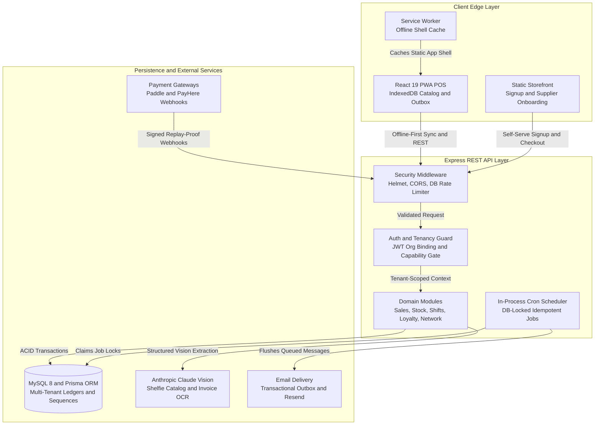
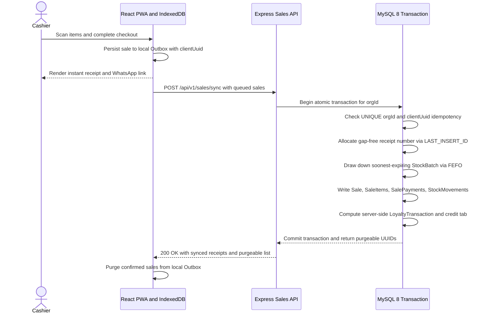
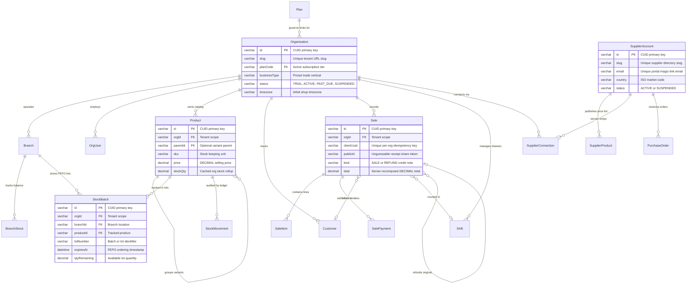

<div align="center">

# Sillara

**Offline-First, Multi-Tenant Point of Sale & B2B Retail Supply Network**  
Built for sub-100ms checkout latency online or offline, capability-driven vertical adaptability, FEFO batch inventory, AI-powered catalog & invoice ingestion, and zero-touch multi-tenant provisioning.

<p>
  
  
  
  
  
  
  
  
</p>

</div>

---

## System Architecture

Sillara decouples point-of-sale checkout responsiveness from network reliability by running the active catalog and sales outbox inside IndexedDB on the client PWA, while enforcing financial integrity, tenant isolation, and idempotency at the MySQL relational layer.



---

## Offline-First Sale Sync & FEFO Settlement Flow

Every checkout completes locally in IndexedDB and mints an idempotent `clientUuid` plus a shareable `publicId` receipt token. When connectivity is available, the background outbox synchronizes batches to the API, where totals, taxes, FEFO lot drawdowns, and loyalty points are authoritatively computed server-side.



---

## Core Multi-Tenant & Supply Network Data Model

The relational schema models 30+ entities spanning strict tenant tenancy, branch-level stock rollups, append-only inventory and loyalty ledgers, split-tender refunds, FEFO stock batches, and the cross-tenant B2B supplier directory.



---

## Core Engineering Highlights

- **Strict Multi-Tenant Isolation & RBAC**: Tenant `orgId` is cryptographically bound into the JWT at login and never read from request parameters or headers. Every authenticated route passes through a 5-second-cached revocation and billing-status guard, multi-shop login selector, 4-digit PIN cashier switching with lockout protection, and MySQL-backed cluster rate limiting.
- **Offline-First Progressive Web App**: Powered by React 19, Vite 6, Tailwind CSS 4, and IndexedDB (`idb`). Product catalog bootstrap caches locally for zero-latency barcode and text search; sales write immediately to a durable client outbox and flush automatically on reconnect with database-enforced `UNIQUE(orgId, clientUuid)` idempotency.
- **Capability-Driven Vertical Architecture**: Supports 11 trade presets (retail, grocery, pharmacy, cafe, apparel, electronics, hardware, and more) with server-resolved capability flags enforcing plan entitlements, feature dependencies, starter catalog seeding, and route-level capability guards.
- **Financial & Ledger Integrity**:
  - All monetary values use `DECIMAL(12,2)` and quantities `DECIMAL(12,3)` with server-recomputed line totals and tax snapshots.
  - Append-only `stock_movements`, `loyalty_transactions`, and `customer_credit_transactions` ledgers serve as the single source of truth behind cached balances.
  - **FEFO Batch & Expiry Tracking**: Automatically allocates outgoing sales from soonest-expiring lots, computes weighted batch costs, and surfaces expiring-stock value-at-risk alerts.
  - **Product Variants**: Parent-child variant groups with matrix option selection on the till and per-variant SKU/stock tracking.
  - **Multi-Tender & Tender-Selectable Refunds**: Split payments (Cash, Card, QR, Customer Credit), partial and full credit-note refunds with selectable refund tender, and atomic shift close validation against unsynced sales.
  - **Concurrency-Safe Receipt Numbering**: Gap-free per-org sequential receipt numbers powered by MySQL `LAST_INSERT_ID(expr)`.
- **AI-Powered Onboarding (Shelfie)**: Uses Anthropic Claude Vision with structured JSON outputs to extract draft product catalogs from shelf/price-list photos and match supplier invoice lines against existing products during goods receiving. Client-side downscaling compresses images to `<=1568px` JPEG before upload.
- **B2B Supplier Network & Privacy-Preserving Demand Analytics**: Connects shops directly to wholesale distributors via a country directory, turning low-stock alerts into one-tap purchase orders. Suppliers access a passwordless magic-link portal displaying anonymized, aggregated product demand without ever exposing individual shop identities.
- **Resilient Background Operations**: In-process `node-cron` jobs protected by database-level execution locks (`job_runs`) handle billing lifecycle state transitions, timezone-aware daily sales digests, transactional email outbox retries, ledger reconciliation, and rate-limit cleanup.
- **Internationalization & Multi-Platform Install**: Per-tenant currency, timezone, and multi-language UI (English, Sinhala, Tamil), installable as a standalone app across macOS, Windows, Linux, iOS, and Android (including Play Store TWA configuration).

---

## Repository Structure

```text
sillara/
├── .github/
│   └── workflows/
│       └── ci.yml                 # Automated typecheck, build, Prisma & MySQL 8 integration CI
├── docs/
│   ├── DEPLOY.md                  # VPS (Nginx + PM2 + MySQL) & Vercel deployment runbook
│   ├── GUIDE.md                   # Complete architecture, API reference & operations guide
│   ├── INSTALL-MAC.md             # Desktop PWA installation & offline verification guide
│   └── SETUP.md                   # Local development & testing environment guide
├── marketing/
│   ├── index.html                 # Static storefront & self-serve signup handoff
│   ├── suppliers.html             # Wholesale supplier self-onboarding portal
│   └── vercel.json                # Edge caching & security headers
├── pos/                           # React 19 + TypeScript + Tailwind CSS 4 Offline-First PWA
│   ├── public/                    # Service worker (sw.js), manifest, TWA assetlinks & icons
│   ├── src/
│   │   ├── components/            # Receipt, RefundSheet, ReceiveGoods, ShelfieImport, VariantPicker
│   │   ├── lib/                   # IndexedDB store, sync engine, API client, i18n, capabilities
│   │   ├── modules/               # Capability-gated POS module registry
│   │   ├── pages/                 # Sell, Stock, Sales, Products, Business, Network, SupplierPortal
│   │   └── state/                 # Global session & capability context
│   └── vite.config.ts
├── server/                        # Node.js 22 + Express + Prisma + MySQL 8 Platform API
│   ├── prisma/
│   │   ├── migrations/            # Versioned SQL migrations
│   │   ├── schema.prisma          # 30+ relational models & composite tenant indexes
│   │   ├── seed.ts                # Tier plan & optional demo supplier seeder
│   │   └── backfill-p3.ts         # Idempotent multi-branch backfill utility
│   ├── src/
│   │   ├── capabilities/          # Capability registry, preset templates & dependency resolver
│   │   ├── config/                # Zod-validated environment schema
│   │   ├── domain/                # Pure business logic (FEFO batches, variants, stock, payments, credit)
│   │   ├── jobs/                  # DB-locked cron jobs (lifecycle, digest, reconcile, cleanup)
│   │   ├── lib/                   # Decimal money, tax engine, IANA timezone math, audit, crypto
│   │   ├── middleware/            # JWT auth, tenant/capability guards, MySQL rate limiter
│   │   ├── modules/               # 15 domain routers (auth, sales, stock, shifts, network, public, etc.)
│   │   └── services/              # Provisioner, lifecycle engine, Shelfie vision, email outbox
│   └── tests/
│       └── integration/           # 12 MySQL-backed integration suites (tenancy, invariants, payments, FEFO)
├── docker-compose.yml             # One-command local MySQL 8 + API stack
└── LICENSE                        # MIT License
```

---

## Getting Started

### Prerequisites

- **Node.js 22+** and **npm**
- **MySQL 8.0+** (or **Docker** with Docker Compose)

### Option 1: Quick Start with Docker Compose (Database + API)

```bash
git clone https://github.com/theekshana-sudeepa/sillara.git
cd sillara

# Start MySQL 8 and the API container (runs migrations automatically)
docker compose up -d --build

# Seed subscription plans inside the API container
docker compose exec api npm run seed
```

Then boot the POS frontend in a separate terminal:

```bash
cd pos
cp .env.example .env
npm ci
npm run dev
# Opens at http://localhost:5273
```

### Option 2: Manual Local Setup

#### 1. Create the MySQL Database

```bash
mysql -u root -e "CREATE DATABASE sillara CHARACTER SET utf8mb4 COLLATE utf8mb4_unicode_ci;"
```

#### 2. Configure and Run the API (`server/`)

```bash
cd server
cp .env.example .env

# Generate two distinct 32-byte hex secrets for JWT_SECRET and MAGIC_LINK_SECRET
node -e "for (const k of ['JWT_SECRET','MAGIC_LINK_SECRET']) console.log(k+'='+require('crypto').randomBytes(32).toString('hex'))"
```

Update `server/.env` with your `DATABASE_URL`, `JWT_SECRET`, and `MAGIC_LINK_SECRET` (optionally add `ANTHROPIC_API_KEY` to enable **Shelfie** AI scanning, or leave it empty to auto-hide the feature).

```bash
npm ci
npx prisma generate
npx prisma migrate deploy
npm run seed          # Seeds FREE / SHOP / PRO plans (set SEED_DEMO=true for demo supplier)
npm run dev           # Runs API on http://localhost:4100
```

#### 3. Configure and Run the POS PWA (`pos/`)

```bash
cd ../pos
cp .env.example .env
npm ci
npm run dev           # Runs POS on http://localhost:5273
```

Visit `http://localhost:5273/signup` to provision a free shop and test the full workflow end-to-end.

---

## Verification & Testing

```bash
# Backend: schema validation, typecheck, build & unit test suite (116 unit tests, no DB required)
cd server
npx prisma validate
npm run typecheck
npm run build
npm test

# Backend: full integration test suite against an isolated MySQL 8 test database
mysql -u root -e "CREATE DATABASE IF NOT EXISTS sillara_test CHARACTER SET utf8mb4 COLLATE utf8mb4_unicode_ci;"
DATABASE_URL="mysql://root:@127.0.0.1:3306/sillara_test" npx prisma migrate deploy
DATABASE_URL="mysql://root:@127.0.0.1:3306/sillara_test" npm run seed
TEST_DATABASE_URL="mysql://root:@127.0.0.1:3306/sillara_test" npm test

# Frontend: strict TypeScript check & production Vite bundle
cd ../pos
npm run typecheck
npm run build
```

---

## Documentation

- [Complete System & API Guide](docs/GUIDE.md) — Architecture rules, feature reference, API endpoints, and operations runbook
- [Local Setup Guide](docs/SETUP.md) — Local environment, background job CLI, and production topology overview
- [Deployment Guide](docs/DEPLOY.md) — Production VPS (Nginx + PM2 + MySQL), Vercel frontends, and Play Store TWA setup
- [macOS PWA Install Guide](docs/INSTALL-MAC.md) — Installing Sillara as a standalone desktop app and verifying offline mode

---

## License

This project is licensed under the **MIT License** — see the [LICENSE](LICENSE) file for details.

---

<div align="center">

**Engineered by Theekshana Sudeepa**  
[LinkedIn](https://www.linkedin.com/in/theekshana-sudeepa/) · [GitHub](https://github.com/theekshana-sudeepa) · [LexoraTech](https://lexoratech.com)

</div>
